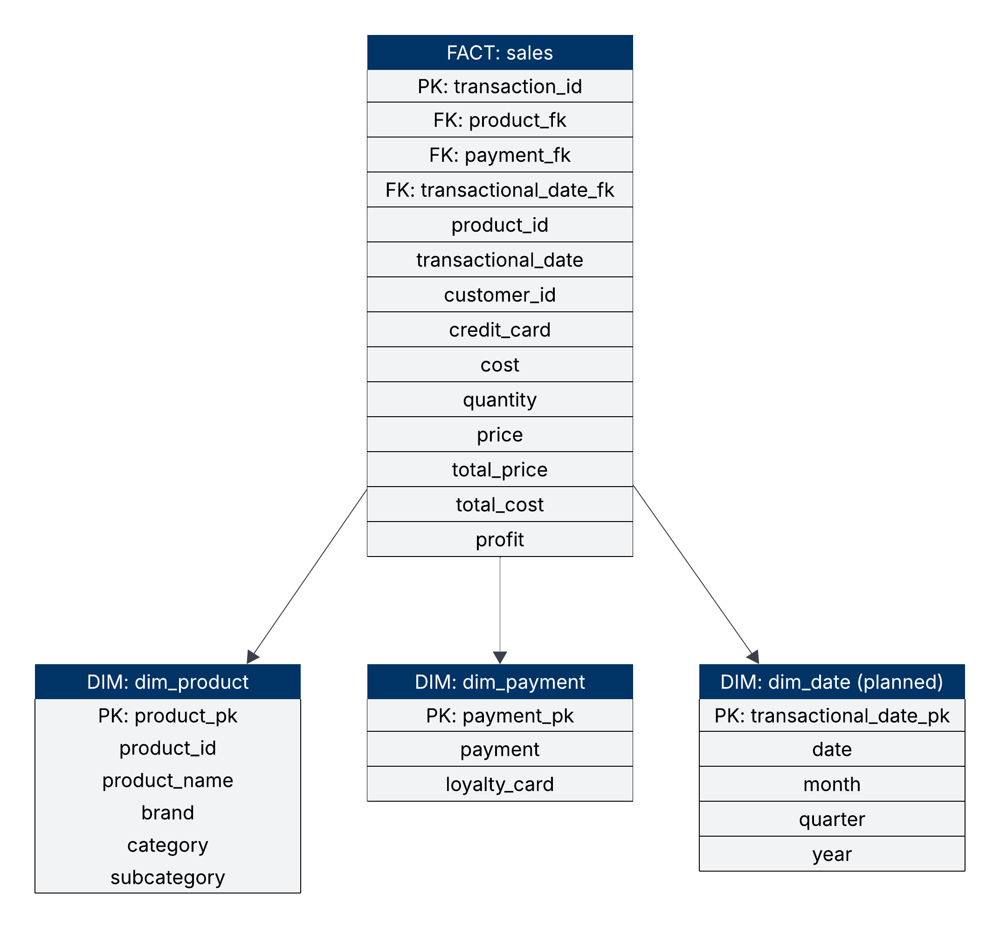

# Sales DWH

Portfolio project built to simulate real business scenario I encountered in my work.

## Project Overview

This project implements a **Sales Data Warehouse (DWH)** designed and orchestrated through **KNIME Analytics Platform**, connected to a **PostgreSQL database hosted on AWS**. The pipeline performs full **ETL (Extract–Transform–Load)** operations — extracting transactional data, transforming it into clean, structured dimensions and facts, and loading it into a star-schema model.

The purpose is to demonstrate a scalable and flexible ETL process using KNIME’s workflow orchestration and PostgreSQL as a backend for analytics-ready storage.

---

## Repository Structure

```
sales_dwh/
│
├── README.md
├── project_overview.md
├── sql_setting_up_tables/
│   ├── create_public_sales.txt
│   └── create_dwh_tables.txt
│
├── images/
│   ├── star_schema.png
│   └── star_schema_transparent_bg.png
│
├── data/
│   ├── fact_sales_1.csv
│   └── fact_sales_2.csv
│
└── knime_etl_process/
    ├── complete_etl_process/
    ├── core_sales_fact/
    ├── core_dim_product/
    ├── core_dim_payment/
    ├── load_and_transform_dim_product/
    ├── get_last_load_staging_sales/
    ├── set_last_load_sales/
    └── write_the_table_dim_product/
```

---

## Architecture

### Tech Stack

- **ETL Tool:** KNIME Analytics Platform  
- **Database Engine:** PostgreSQL on AWS  
- **Access Tool:** pgAdmin for database management and testing

### Schema Design

The warehouse follows a **star schema**, composed of:
- **Fact Table:** `core.sales`
- **Dimension Tables:**  
  - `core.dim_product`  
  - `core.dim_payment`  
  - `core.dim_date` *(planned)*  



---

## How to Use

### Prerequisites
- **KNIME Analytics Platform**
- **PostgreSQL**
- **pgAdmin** or compatible SQL client
- **AWS RDS or EC2 PostgreSQL instance** for hosting the database

### Steps
1. **Clone the repository:**
   ```bash
   git clone https://github.com/artemietu/sales_dwh
   cd sales_dwh
   ```

2. **Set up database tables:**
   - Run the scripts inside `sql_setting_up_tables/` (`create_public_sales.txt` and `create_dwh_tables.txt`) to initialize both staging and core schemas.

3. **Open KNIME workflows:**
   - Launch KNIME Analytics Platform.
   - Import all workflows from the `knime_etl_process/` directory.

4. **Configure connection parameters:**
   - Open the **PostgreSQL Connection** node in each workflow.
   - Enter your AWS endpoint, port, database name, username, and password.

5. **Run the complete ETL pipeline:**
   - Execute `complete_etl_process` to trigger all sub-workflows.
   - Check the database for updated fact and dimension tables.

6. **Validate results:**
   - Query the core schema using `pgAdmin` or your SQL client.
   - Visualize relationships according to the included star schema diagram in `/images`.

---

## Author

Artemie Țurcanu — Data Analyst
